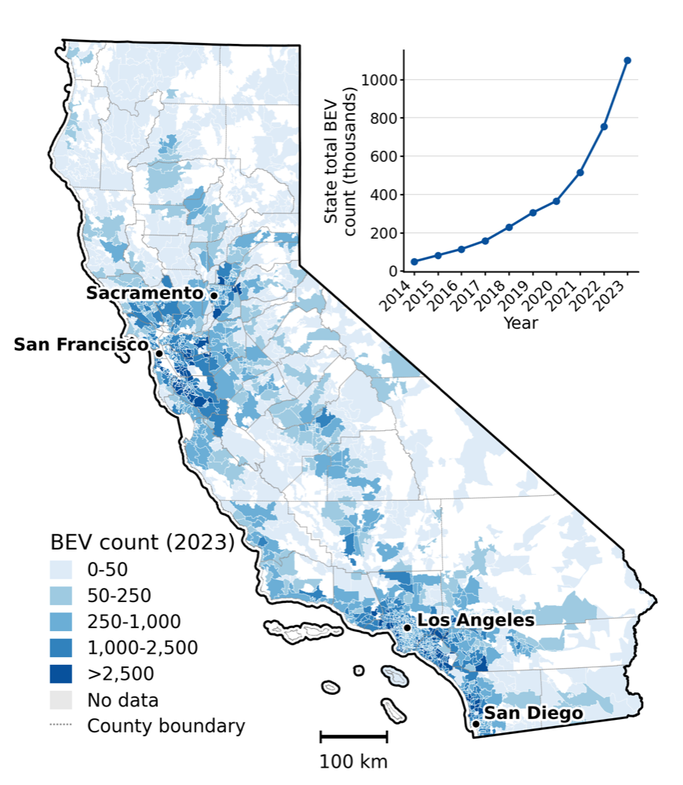
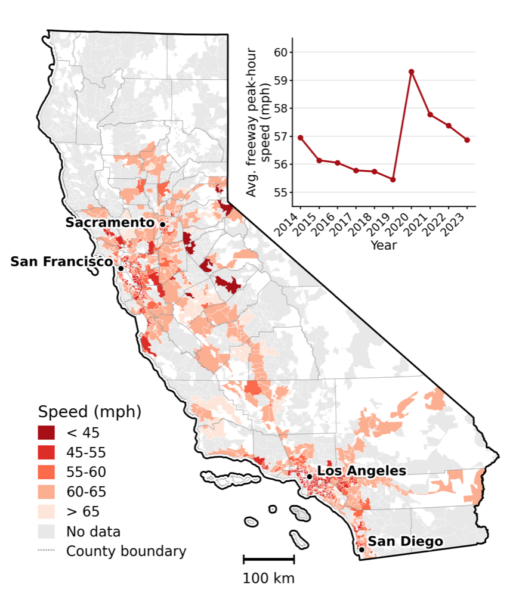

# The electric vehicle transition exacerbates traffic congestion in California

[](https://github.com/ruoyuch/ev-congestion-public/actions/workflows/ci.yml)

Source code for *"[The electric vehicle transition exacerbates traffic
congestion in California](https://www.rchen.info/pdf/wp_ev_congestion.pdf)"*.

## Summary

**Doubling a ZIP code's battery-EV fleet cuts nearby peak-hour freeway speeds
by 0.69%, while midnight speeds (as placebo) do not change. Statewide, that costs about $362 million a year in lost travel time.**

<p align="center">
  
  
  <br>
  <sub>Left: BEV count by ZIP code, 2023; Right: average weekday peak-hour freeway speed.</sub>
</p>

| | |
|---|---|
| **Data** | 40,000+ PeMS freeway sensors + ZIP-level vehicle registrations → 10-year ZIP-code panel|
| **Method** | Two-way fixed effects (ZIP, year) with SEs clustered by ZIP → elasticity −0.0099***|
| **Mechanisms** | Fleet expansion, induced travel, falling transit ridership |

## Identification

The identification assumes within-ZIP changes in BEV adoption are not driven
by unobserved shocks to peak-hour demand. Three groups of checks test it:

| Threat | Check | Result |
|---|---|---|
| **1. Omitted shocks** | Midnight speed as placebo outcome | No negative effect |
| | ZIP + county-year FE; drop 2020–21 | −0.0056\*\*; −0.0072\*\*\* |
| | 1,000 permutations; leave one out | p < 0.001; stable |
| **2. Spatial spillovers** | Outcome: speeds within 1–15 km radii | Negative at every radius; midnight ≈ 0 |
| | Treatment: BEVs in 5–10 and 5–15 km rings | −0.0099 to −0.0256, all significant |
| **3. Reverse causality** | BEVs lagged 3 years | Negative, significant |
| | IV: high-income share × 2016 rebate reform | −0.0269\*|

## Reproduce

Requires [uv](https://docs.astral.sh/uv/) and Stata 17+.

```bash
# set up environment
uv sync                                           # set venv
cp .env.example .env                              # set STATA_BIN
(cd stata && stata-mp -b do install_packages.do)  # install stata packages
# run pipeline
uv run pipeline/run_all.py                        # reproduce ~2 min from shipped data
uv run pytest                                     # regenerated tables == published
```

The pipeline runs `station_year → zip_traffic → vehicles → covariates → transit
→ neighbors → stata → maps`: Python (`src/ev_congestion/`) builds the ZIP-year
panel, and Stata (`stata/`) runs the regressions. Stages with existing outputs
are skipped; see `--list`, `--from <stage>`, `--only <stage>`, `--force`.

<details>
<summary>Exhibit map</summary>

| Exhibit | Script | Output (`output/`) |
|---|---|---|
| Fig. 1: BEV growth and speed maps | `src/ev_congestion/maps.py` | `figures/map_*.png` |
| Table 1: speed (TWFE, county-year FE, 2SLS) | `stata/02_main_tables.do` | `tables/twfe_speed_regs.tex` |
| Fig. 2: effects by radius | `stata/03_spatial_scale.do` | `figures/spillover_radius_effects_*.pdf` |
| Table 2: mechanisms | `stata/02_main_tables.do` | `tables/twfe_mechanism_regs.tex` |
| Fig. 3: heterogeneity | `stata/04_heterogeneity.do` | `figures/heterogeneity_split*.pdf` |
| Fig. A2, Table A1: IV | `stata/06_iv.do` | `figures/cvrp_bin_es_fs.pdf`, `tables/cvrp_iv_table.tex` |
| Fig. A3–A4: permutation, leave-one-out | `stata/09_randomization.do` | `figures/permutation_test.pdf`, `loo_*.pdf` |
| Table A2: lagged BEVs | `stata/05_lagged.do` | `tables/twfe_speed_regs_lag.tex` |
| Table A3: rings | `stata/08_rings.do` | `tables/donut_regs.tex` |
| Table A4: COVID | `stata/07_covid.do` | `tables/twfe_speed_regs_covid.tex` |
| Table A5: FE robustness | `stata/10_fe_robustness.do` | `tables/twfe_speed_regs_robust_*.tex` |

</details>

<details>
<summary>Setup notes, run times, raw data</summary>

- **macOS:** Stata is not on PATH. Use the full path, e.g.
  `/Applications/Stata/StataMP.app/Contents/MacOS/stata-mp`, in the install
  command and for `STATA_BIN`.
- **Manuscript:** `(cd docs && latexmk -pdf -outdir=out manuscript.tex)` (TeX Live).
- **Run times** (M2 Max, 64 GB): ~2 min from `data/intermediate/`; ~3 min from
  `data/input/` (`--from zip_traffic --force`); ~5 min per year from raw PeMS
  (`--from station_year --force`).
- **Raw PeMS data** (~22 GB/year, free account at <https://pems.dot.ca.gov>) is
  not needed to replicate. Set `RAW_PEMS_DIR` to rebuild from it; a fresh
  download can differ slightly because PeMS revises station metadata.

</details>

Data sources and variable definitions: [`data/README.md`](data/README.md).

## License

The code is published by [Ruoyu Chen](https://www.rchen.info), Hang Liu, and Mingzhi Zhou under the MIT license.
The data generated by the code (`data/intermediate/`, `data/input/traffic_station_year/`) is available under CC BY 4.0.

Third-party files keep their original terms.
The data and files generated from official sources are freely available for public use, as long as the working paper is cited as a source.

## Suggested citation
R. Chen, H. Liu, M. Zhou, 2026. The electric vehicle transition exacerbates traffic congestion in California.